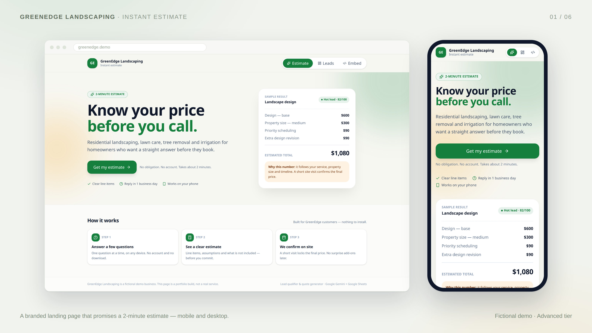
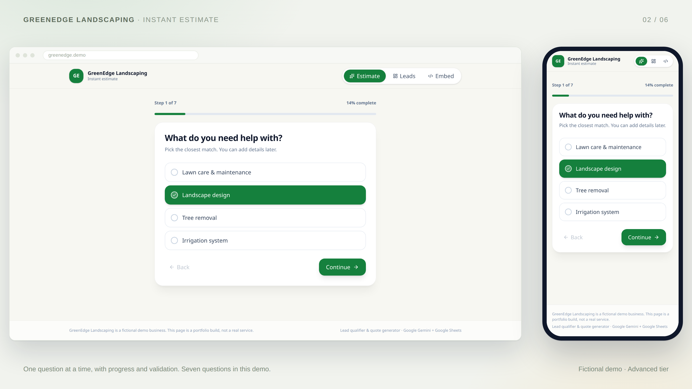
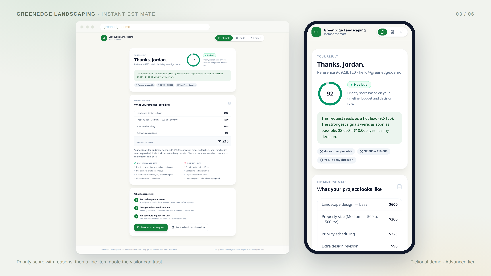
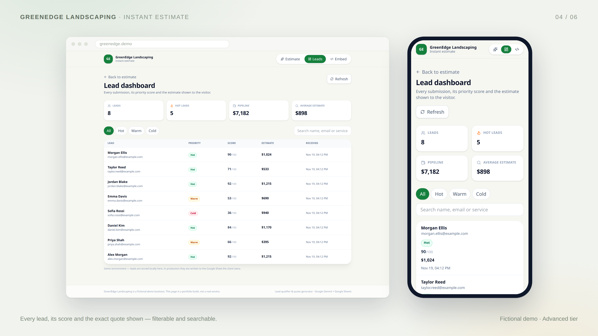
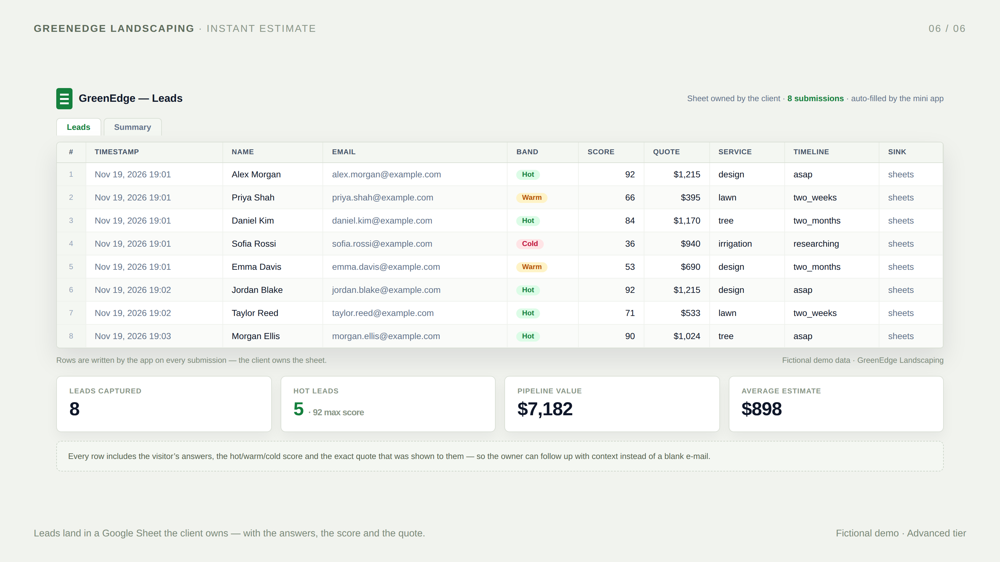

# Lead Qualifier / Instant Quote Generator

A mini app that can be linked or embedded on a business website. Visitors answer a
short, smart question flow; the app either scores them (hot / warm / cold) or
produces an instant, clearly explained estimate based on the business's own
pricing rules. Every submission is written to a Google Sheet owned by the client.

> Portfolio repository for **Upwork Project B — Lead qualifier / quote generator**.
> The working demo is built and documented in
> [docs/DEMO.md](docs/DEMO.md); screenshots and the 50-second walkthrough are in
> [`gallery/`](gallery/). The application source is delivered to the client with
> the project and is not published here.



---

## What the service delivers

| Tier | Delivered |
|---|---|
| **Starter — Lead Qualifier Mini App** | 5–8 questions, AI hot/warm/cold score, leads saved to Google Sheets |
| **Standard — Instant Quote Generator** | Client services + price rules, AI-written instant quote, e-mail alert |
| **Advanced — Qualifier + Quote + Dashboard** | Both flows, simple lead dashboard, custom branding |

All tiers are responsive and deployed live. Source code and content upload are
included from Standard; design customization is exclusive to Advanced.

---

## How it works

```
visitor ──▶ embeddable widget / standalone link
                 │  5–8 questions (qualification) or service inputs (quote)
                 ▼
          rules engine  ── deterministic score or price (never invented by the AI)
                 ▼
          Google Gemini ── human-readable explanation of the result
                 ▼
          Google Sheets ── client-owned lead row (+ e-mail alert on Standard/Advanced)
                 ▼
          lead dashboard (Advanced only)
```

**Key rule:** the numbers come from the client's pricing rules. Gemini only
explains them. The same applies to scoring: weights are explicit and auditable.

---

## Demo

Built with a fictional client, **GreenEdge Landscaping**, at the Advanced tier.

| | |
|---|---|
|  |  |
|  |  |

- **Walkthrough video (50 s):** [`gallery/demo-walkthrough.mp4`](gallery/demo-walkthrough.mp4)
- **Sample leads:** [`gallery/sample-leads.csv`](gallery/sample-leads.csv)
- **Full description, scoring example and shot list:** [docs/DEMO.md](docs/DEMO.md)

Example from the demo: *landscape design · medium property · as soon as
possible · $2,000–$10,000 · decision maker · referral* → **92/100, hot** and a
**$1,215** estimate built from the price rules.

---

## Stack

- React 19 + TypeScript + Vite 8
- Tailwind CSS 4 + Lucide icons
- Node.js + Express proxy for `@google/genai` (API key stays server-side)
- Google Sheets API via service account (JWT, no SDK) — with local JSONL/CSV fallback
- Shadow-DOM embeddable widget, plus a direct link

## Reused patterns

This repo deliberately reuses proven pieces from the existing portfolio instead
of starting from zero:

- `Agent-StudyDeck-Mini-Guia-de-Estudos-` — `BrandContext` (logo, colors, app
  name), PWA setup, server-side Gemini proxy and deployment docs.
- `faq-lead-chatbot` — Google Sheets sink with local fallback, embeddable
  Shadow-DOM widget and multi-client config layout.
- `Agent-EducaFinance-AI` — question → deterministic analysis → AI explanation
  flow (`BudgetDiagnostic503020.tsx` + `/api/diagnose`).

## Repository layout

```
docs/DEMO.md                     the built demo: screenshots, scoring, shot list
docs/ARCHITECTURE.md             design decisions and data flow
gallery/                         screenshots, sample leads CSV, walkthrough video
examples/questions.example.json  5–8 question flow (Starter)
examples/pricing-rules.example.json explicit price rules (Standard)
.env.example                     required environment variables
```

## Configuration

```bash
npm install
cp .env.example .env
npm run dev
```

Configure `SHEET_ID` and `GOOGLE_SERVICE_ACCOUNT` to persist leads, or leave
`LEAD_SINK=local` for a demo that writes to `data/leads.jsonl`. Set
`PUBLIC_ORIGIN` to the deployed URL so the embed snippet shows the real domain.

See [docs/ARCHITECTURE.md](docs/ARCHITECTURE.md) for the design and
[docs/DEMO.md](docs/DEMO.md) for the built demo.
