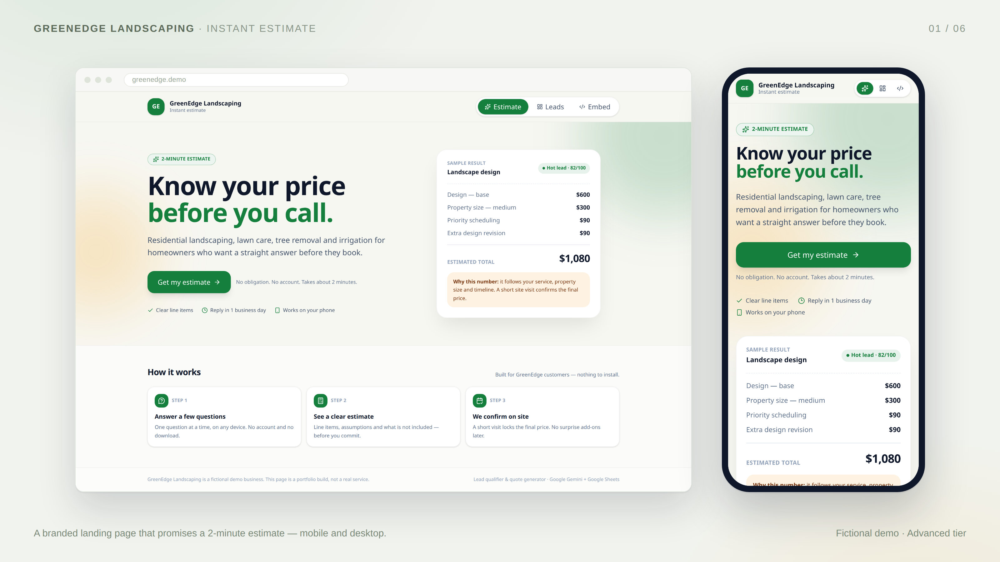
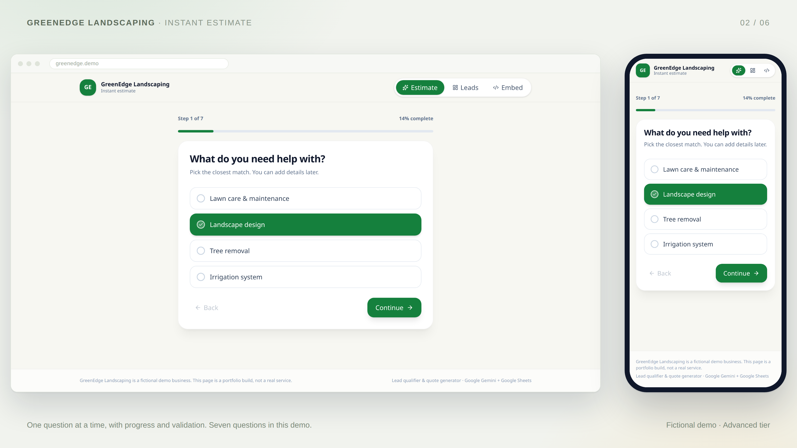
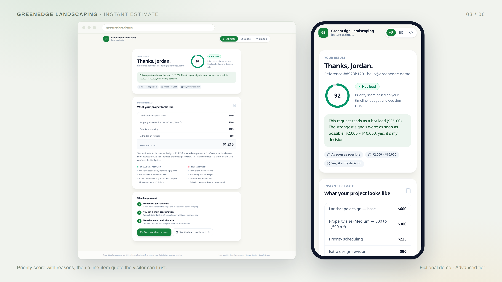
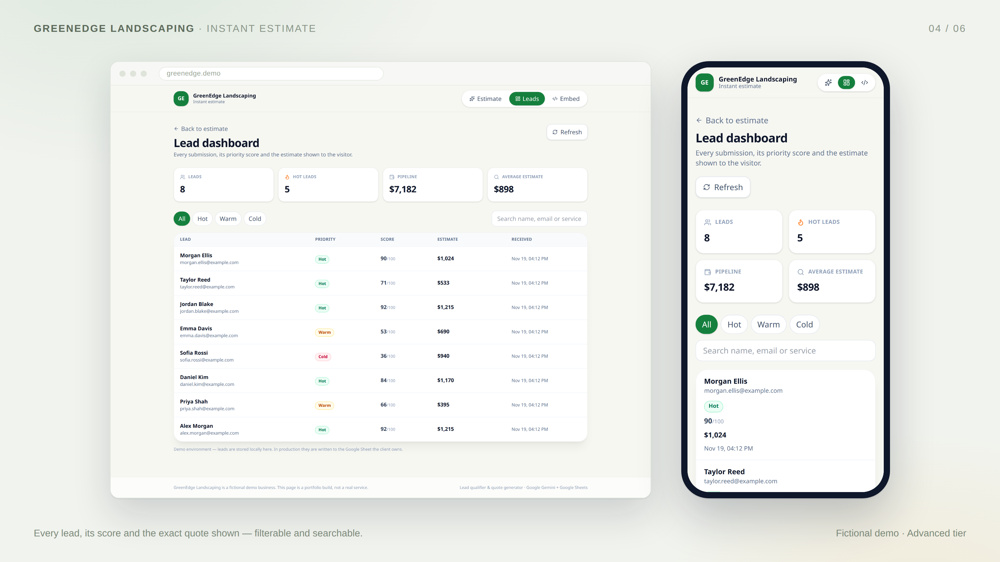
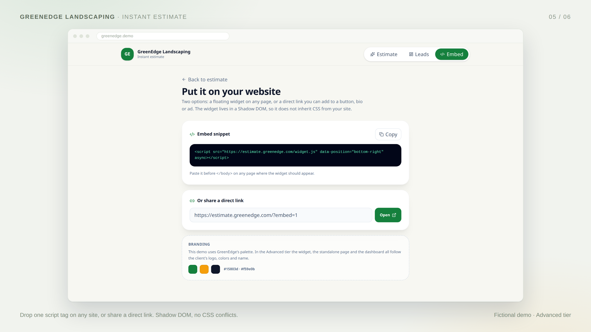
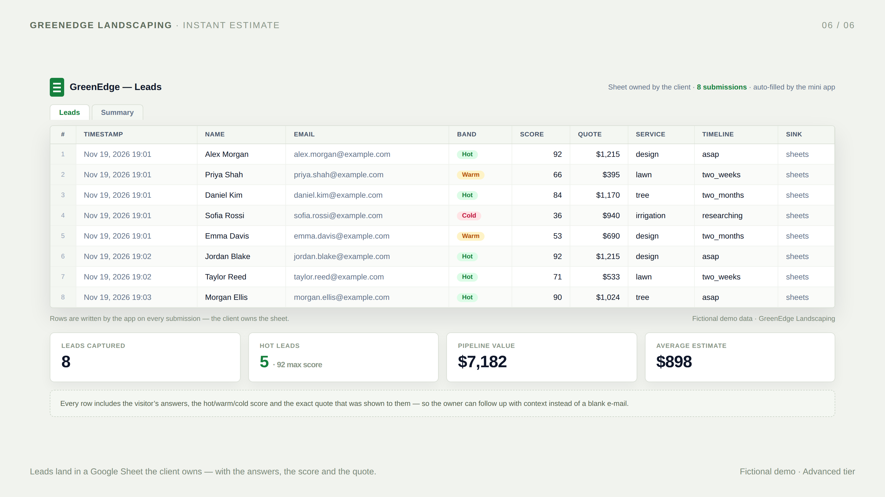

# Demo — Advanced tier walkthrough

A working build of the **Advanced** package: qualifier + instant quote + lead
dashboard + custom branding, all in one embeddable mini app.

The demo client is **GreenEdge Landscaping**, a fictional residential
landscaping business. Every name, e-mail and amount in the screenshots is
invented for the demo.

- **Live demo:** not published yet — the build runs locally (`npm run dev`)
  until a host and a Gemini key are attached.
- **Video:** [`gallery/demo-walkthrough.mp4`](../gallery/demo-walkthrough.mp4) — 50 s, 1280×720.

---

## What the demo covers

| Requirement | Where it shows up |
|---|---|
| 5–8 question flow | 7 questions, one per screen, with progress and validation |
| AI hot / warm / cold score | Deterministic weighted score + Gemini-written explanation |
| Instant quote from explicit price rules | Line items, total, assumptions and exclusions |
| Google Sheets lead capture | Service-account sink, with local JSONL/CSV fallback |
| Lead dashboard | Filter by band, search, pipeline and average estimate |
| Custom branding | Logo mark, colors and name drive the whole UI |
| Responsive / mobile | Same flow, tested at 390 px and 1440 px |
| Embeddable | One `<script>` tag, Shadow DOM widget, or a direct link |

## Screenshots

| | |
|---|---|
|  |  |
| **01 — Landing page.** Branded hero, sample result, how it works. | **02 — Question flow.** One question at a time, 14% after the first answer. |
|  |  |
| **03 — Result.** Priority score with reasons, then the line-item quote. | **04 — Dashboard.** Every lead, score and quote; filter and search. |
|  |  |
| **05 — Embed.** Script tag or direct link, with brand tokens. | **06 — Sheet.** What the client sees in Google Sheets. |

The spreadsheet screenshot is a rendering of
[`gallery/sample-leads.csv`](../gallery/sample-leads.csv) — the same rows the
local sink writes, with the same columns the Sheets sink appends.

## How the numbers are produced

**Score.** Each answer option carries a weight in the client config. The score
is `earned / maximum × 100`, and the band is the first one whose threshold is
met (hot ≥ 70, warm ≥ 40, cold < 40). The weights are in the config, so a client
can audit why a lead was classified as hot.

Example used in the demo: *landscape design · medium property · as soon as
possible · $2,000–$10,000 · decision maker · referral* → **92/100, hot**.

**Quote.** Every amount comes from the pricing rules: base by service × size
multiplier, plus a priority-scheduling delta and any add-on whose condition
matches.

The same example: base $600, size +$300, priority +$225, extra design revision
+$90 → **$1,215**. Gemini rewrites the explanation; it never invents a number.

If `GEMINI_API_KEY` is missing or the call fails, the app falls back to a
deterministic explanation and the flow keeps working.

## What is fictional

- The business, its logo, phone number and e-mail addresses.
- The leads and the prices. The price table is plausible for the demo business,
  not a real quote from anyone.
- The domain in the embed snippet (`estimate.greenedge.com`) is a placeholder.

## What changes for a real client

1. `clients/<slug>/config.json` — services, questions, weights, bands, price
   rules, exclusions, branding and contact details.
2. `LEAD_SINK=sheets` plus a service account and the client's `SHEET_ID`.
3. `GEMINI_API_KEY` in the host environment.
4. `PUBLIC_ORIGIN` set to the deployed URL, so the embed snippet is copy-paste
   ready.

Nothing in the engine is hard-coded to the demo business.

## Running it

The source is delivered to the client with the project; it is not published in
this showcase repository. Locally:

```bash
npm install
cp .env.example .env
npm run dev
```

Then open <http://localhost:3000>. Without a Gemini key the app runs in
deterministic mode; without Sheets credentials it writes to
`data/leads.jsonl` and `data/leads.csv`.

## Video shot list

The 50-second walkthrough was recorded from the running app, in this order:

1. Landing page — brand, promise, sample result.
2. Question flow — six option questions answered, contact form filled.
3. Result — score ring, reasons, line-item quote, assumptions.
4. Scroll through the quote and the "what happens next" steps.
5. Lead dashboard — the new lead at the top, filters and stats.
6. Embed page — snippet and direct link.

It is a screen recording of the real build, not a mockup.
